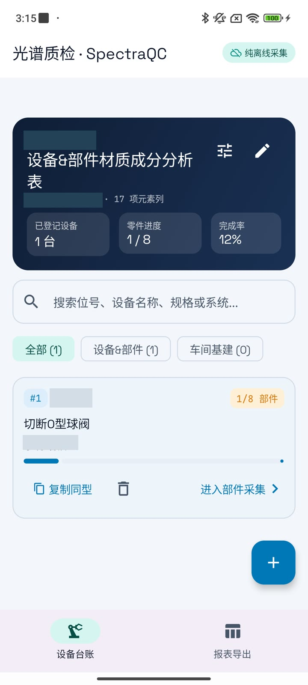
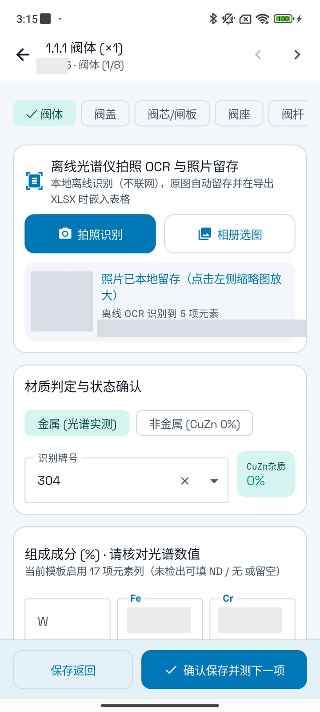

# SpectraQC

**Android 光谱材质检测与质量记录工具 · Spectrometer Quality Control**

SpectraQC 面向工业设备、阀门及车间设施的现场材质检测记录，帮助质量人员将光谱仪读数、设备信息、检测部位及现场照片整理为结构化记录，并导出 Excel 报告。

## 界面预览 / Screenshots

<p align="center">
  
  &nbsp;&nbsp;
  
</p>

<p align="center">设备台账与检测进度 · 离线光谱 OCR 与材质检测</p>

*截图中的内部编号、原始照片及部分检测数据已脱敏。*

## 功能特性

- 设备台账与检测部位管理，支持设备复制、自定义部位及检测状态。
- 内置 O 型切断球阀（23 项）、通用工业阀门（8 项）、车间基建（5 项）和空白设备模板。
- 支持维护检测字段、元素项目以及历史输入候选值。
- 使用 Google ML Kit 在设备端识别光谱仪屏幕照片，提取材质牌号与元素含量，支持多列布局、倾斜图像、ppm 及 ND（未检出）等表示。
- 基于 Room 的本地数据存储，保存设备、检测记录及照片；核心记录与 OCR 不依赖云端 API 密钥。
- 导出结构化 XLSX 报告，支持自定义字段及嵌入检测照片。

## 使用流程

1. 新建检测设备并选择模板。
2. 选择检测部位，录入或拍摄光谱仪读数。
3. 核对 OCR 提取结果，补充检测信息及照片。
4. 查看结构化报告，导出并分享 Excel 文件。

> OCR 结果仅用于辅助录入，不替代仪器原始读数、检验人员复核或正式质量判定。ND 表示未检出，不应直接视为数值零。

## 安装

Android 7.0（API 24）及以上。版本发布见 [GitHub Releases](https://github.com/time-peddler/SpectraQC/releases)。如该版本仅提供源码，请按下文构建。安装 APK 前请核对来源及签名。

## 技术架构

| 项目 | 技术 |
| --- | --- |
| Android UI | Kotlin、Jetpack Compose、Material 3 |
| 本地存储 | Room |
| OCR | Google ML Kit Text Recognition（含中文） |
| 数据流 | Kotlin Coroutines、Flow、ViewModel |
| 报告 | XLSX / OOXML |
| 构建 | Gradle 9.3.1、JDK 21、Android SDK 36.1 |

## 本地构建（Ubuntu）

安装 JDK 21、Gradle 9.3.1、Android SDK Platform 36.1 及对应 Build Tools，设置 `JAVA_HOME` 和 `ANDROID_HOME`；在项目根目录创建未纳入版本控制的 `local.properties`，内容为 `sdk.dir=/path/to/android/sdk`。

```bash
git clone https://github.com/time-peddler/SpectraQC.git
cd SpectraQC
# 项目未附带完整 Gradle Wrapper，请使用本机 Gradle 9.3.1。
keytool -genkeypair -keystore debug.keystore -storepass android \
  -keypass android -alias androiddebugkey -keyalg RSA -keysize 2048 \
  -validity 10000 -dname "CN=Android Debug,O=Android,C=US"
gradle :app:testDebugUnitTest :app:assembleDebug
```

调试 APK：`app/build/outputs/apk/debug/app-debug.apk`。若已有 `debug.keystore`，无需重新生成。

正式签名构建需要自有签名文件（别名 `upload`），在本地安全设置 `KEYSTORE_PATH`、`STORE_PASSWORD`、`KEY_PASSWORD` 环境变量后执行：

```bash
gradle :app:assembleRelease
```

正式 APK：`app/build/outputs/apk/release/app-release.apk`。签名密钥必须单独备份，后续更新应使用同一签名。不要把密钥、密码、个人配置或真实检测数据提交到仓库。

## 项目结构

```text
app/src/main/java/com/example/
├── data/         # 数据仓库、OCR 与 Room
├── model/        # 设备、检测部位及模板模型
├── ui/           # Compose 界面与 ViewModel
└── util/         # 照片管理与 XLSX 导出
app/src/test/     # 业务逻辑、OCR 与报告测试
```

## 版本与反馈

首个正式版本：**v1.0.0**。欢迎通过 [Issues](https://github.com/time-peddler/SpectraQC/issues) 提交问题及功能建议。请勿上传含客户信息、内部检测记录或凭据的附件。

仓库目前未声明开源许可证；公开可见不代表已授权再分发或商业使用。
